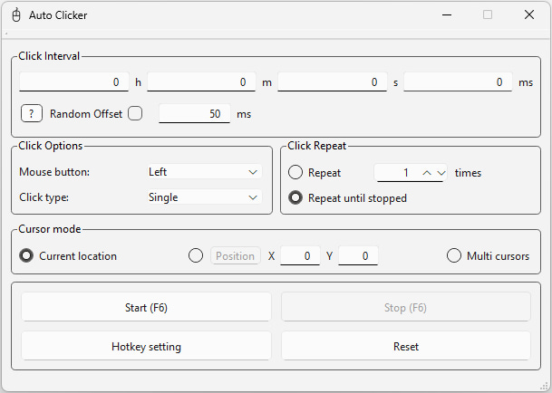
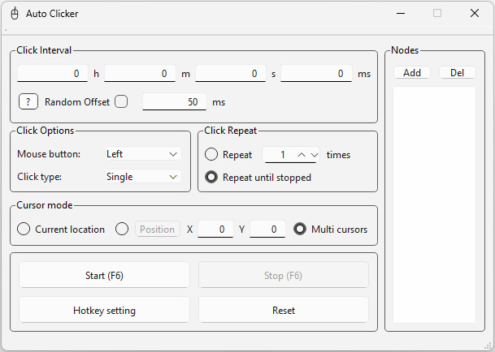

# AutoClicker

A multi-threaded auto-clicker for Windows, developed using **C++**, **Qt Widgets**, and the low-level **Win32 API**. The program is designed to automate clicking tasks, featuring support for multiple points (nodes), global hotkeys, and smooth operation without interface freezing.

<p align="center">
  
  
</p>

---

## Key Features

* **Multi-threaded Architecture:** All click simulation logic runs in a separate background thread (`QThread`); this ensures the GUI never freezes, while the stop button responds instantly via thread-safe flags (`std::atomic`).
* **Interactive Nodes (Markers):** Supports creating multiple click points with visual floating markers (`NodeMarker`) that can be dragged directly on the screen.
* **Global Hotkeys:** Control the clicker (start/stop) using system-wide hotkeys via the Win32 API (`RegisterHotKey`), alongside an advanced key interceptor based on low-level hooks (`SetWindowsHookEx`).
* **Direct Windows API Integration:** Uses high-performance functions like `SendInput` and `SetCursorPos`, allowing the clicker to function correctly over any third-party applications or games.
* **Automatic Settings Persistence:** All parameters, delays, and the array of active nodes are saved to the Windows Registry using `QSettings`.
* **System Tray Support:** Ability to minimize the application to the system tray (`QSystemTrayIcon`) for background operation.

---

## Technology Stack

* **Programming Language:** C++
* **GUI Framework:** Qt Widgets
* **System Interaction:** Win32 API (User32)
* **Development Environment:** Visual Studio

---

## Project Structure

* `include/` — Header files (`.h`):
* `AutoClicker.h` — Main window and system tray icon. 
* `Functional.h` — Core logic, interface, and settings management. 
* `ClickLMR.h` — Background thread for click simulation. 
* `HotkeySetting.h` — Hotkey interception manager. 
* `NodeMarker.h` & `PositionPicker.h` — Overlays for coordinate selection and point visualization.
* `src/` — Module implementation source code (`.cpp`).
* `resources/` — Graphical assets, application icon (`mouse.ico`), and interface files (`.ui`, `.qrc`).

---

## Build and Run

1. Ensure you have **Visual Studio** installed with C++ support and a configured **Qt** environment (compatible with the MSVC compiler).
2. Clone the repository:
```bash
git clone [https://github.com/acidhood999/AutoClicker.git](https://github.com/acidhood999/AutoClicker.git)

[Download AutoClicker (v1.0.0)](https://github.com/acidhood999/AutoClicker/releases/latest/download/AutoClicker-v1.0.0-win64.zip)
